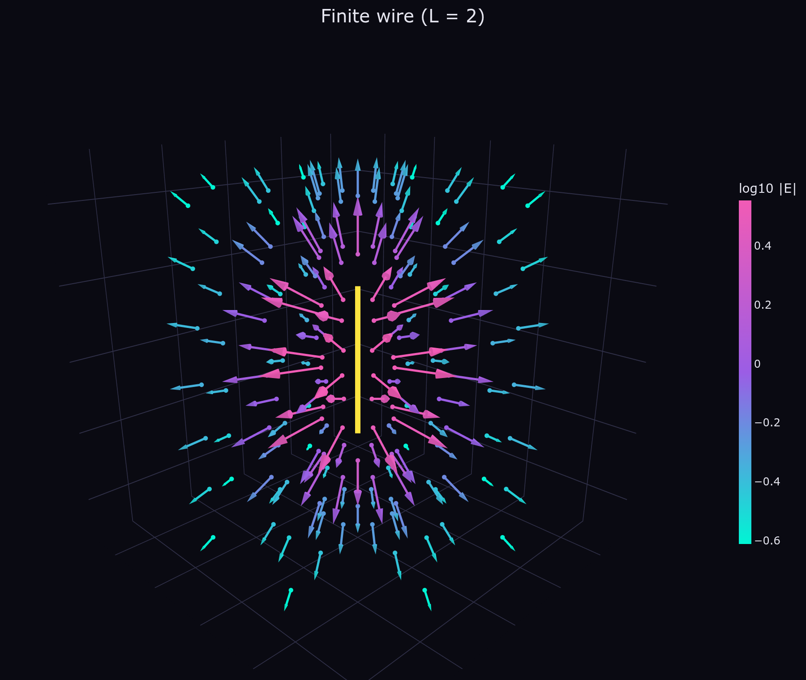
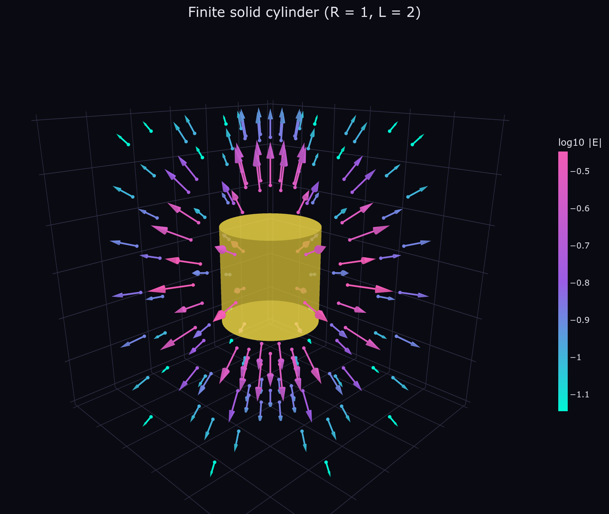
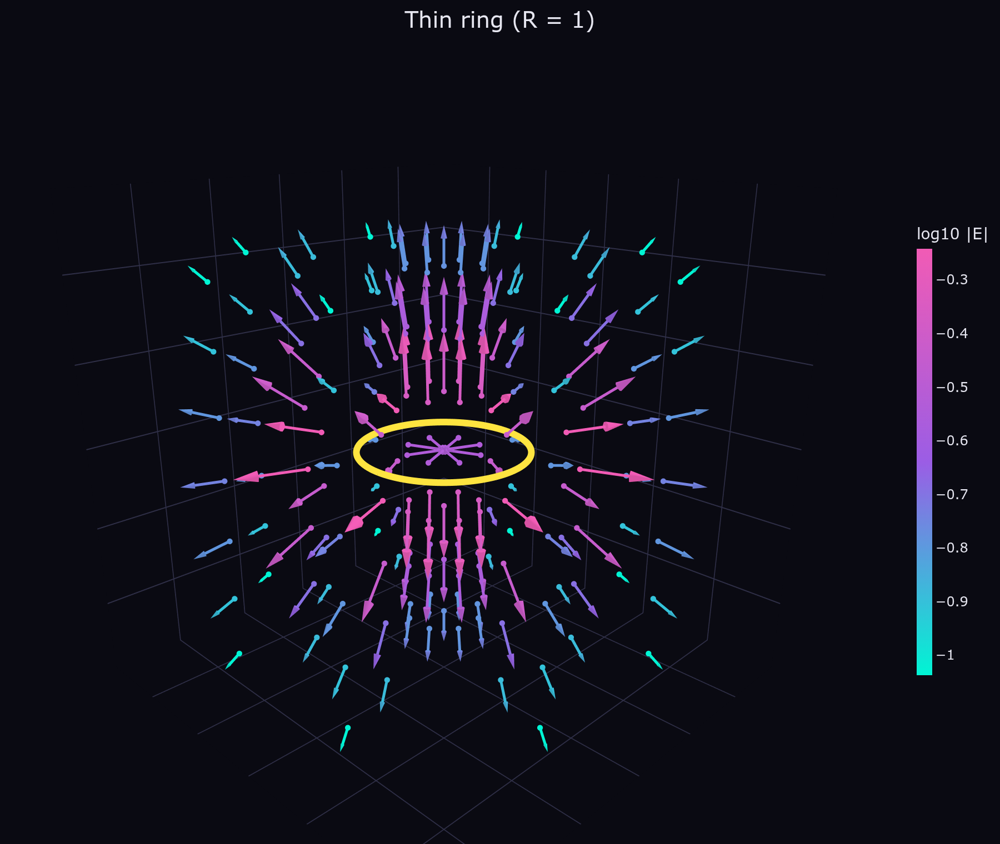
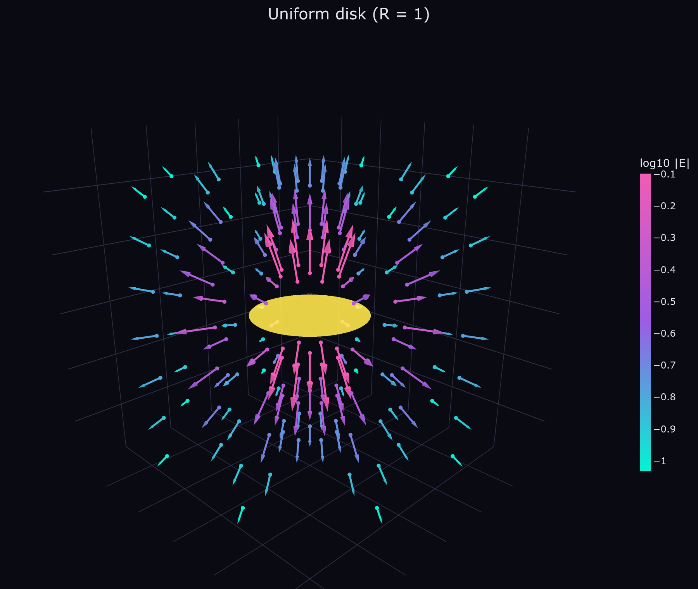
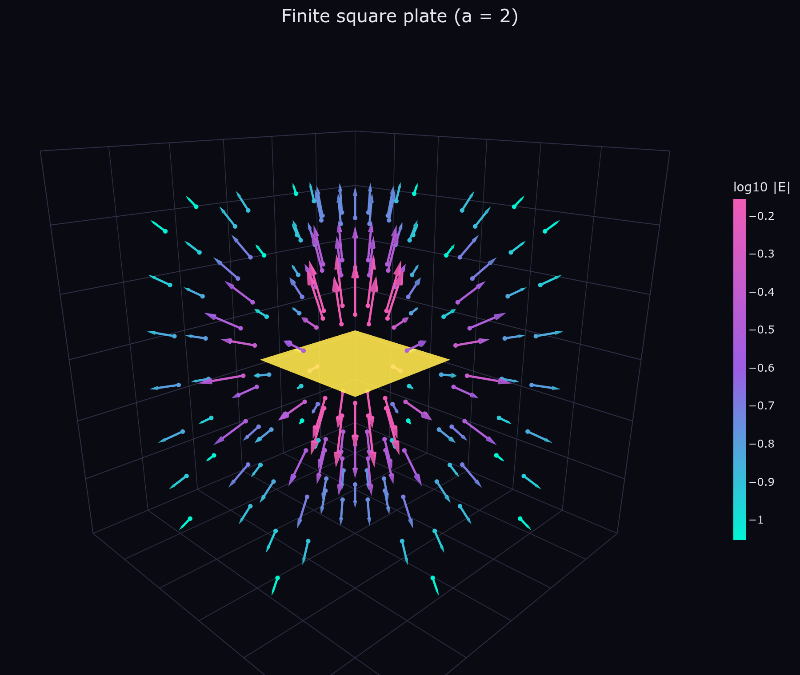
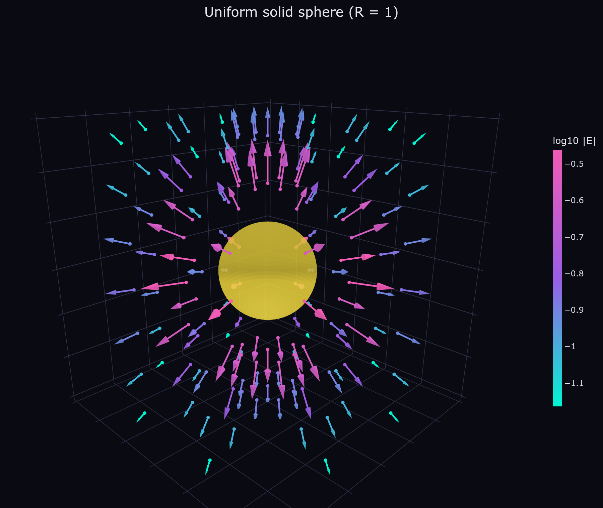

# Electric field of finite charge distributions

### Why Gauss's law is not enough, and what to do instead

[](https://www.python.org/)
[](https://numpy.org/)
[](https://plotly.com/)
[](LICENSE)

| Finite wire | Finite solid cylinder |
|:---:|:---:|
|  |  |
| **Thin ring** | **Uniform disk** |
|  |  |
| **Finite square plate** | **Uniform solid sphere** |
|  |  |

<sub>Arrows give the direction of the field; colour and arrow size give log<sub>10</sub>|E| (cyan = weak, magenta = strong). All charges are positive.
All six are computed by direct numerical integration of Coulomb's law.</sub>

---

## Motivation

Gauss's law gives the field in one line whenever the charge distribution is
**symmetric enough**: an infinite line, an infinite plane, an infinite cylinder.
Those are the textbook shortcuts.

Real objects are **finite**. A wire has ends, a cylinder has two caps, a disk has an
edge. For those shapes the symmetry that Gauss's law needs is broken, and the field
must be obtained by **direct integration** of Coulomb's law:

```math
\vec E(\vec r) = \frac{1}{4\pi\varepsilon_0}\int \frac{(\vec r-\vec r\,')\,dq'}{|\vec r-\vec r\,'|^{3}}
```

This repository works through six finite shapes:

| Shape | Charge | Integration |
|---|---|---|
| Finite wire | linear density λ, length L | 1D |
| Finite solid cylinder | volume density ρ, radius R, length L | 3D |
| Thin ring | total Q, radius R | 1D |
| Uniform disk | surface density σ, radius R | 2D |
| Finite square plate | surface density σ, side a | 2D |
| Uniform solid sphere | volume density ρ, radius R | 3D |

For each one: the setup, the integral, a check against a closed form where one exists,
and a limit that connects it back to the infinite case Gauss's law handles.

Throughout, $k = \dfrac{1}{4\pi\varepsilon_0}$. The code sets $k = 1$, so charges and fields are dimensionless.

---

## 1. Finite wire

Charge element $dq' = \lambda dz'$ at $\vec r ' = (0,0,z')$, with $-L/2 \le z' \le L/2$. For a
field point at cylindrical distance $\rho$ from the wire and height $z$, define
$a = z + L/2$ and $b = z - L/2$. Integrating the components gives

```math
E_\rho = \frac{k\lambda}{\rho}\left(\frac{a}{\sqrt{\rho^2+a^2}} - \frac{b}{\sqrt{\rho^2+b^2}}\right),
\qquad
E_z = k\lambda\left(\frac{1}{\sqrt{\rho^2+b^2}} - \frac{1}{\sqrt{\rho^2+a^2}}\right).
```

**Limit $L\to\infty$:** $a\to\infty$, $b\to-\infty$, so $E_\rho \to 2k\lambda/\rho$, the Gauss result for an infinite line.

## 2. Finite solid cylinder

Volume element $dq' = \rho_v  r' dr' d\varphi' dz'$, with $\rho_v = Q/(\pi R^2 L)$. There is no closed
form for a general point, so the field is a **triple integral**, evaluated numerically with
Gauss–Legendre nodes in $r'$ and $z'$ and a uniform grid in $\varphi'$.

On the axis, the cylinder is a stack of thin disks. Each disk of thickness $dz'$ contributes
(see section 4):

```math
E_z(z) = 2\pi k\rho_v\int_{-L/2}^{L/2}\mathrm{sgn}(z-z')\left[1-\frac{|z-z'|}{\sqrt{(z-z')^2+R^2}}\right]dz'.
```

**Limit $L\to\infty$:** far from the caps, the field tends to the Gauss result for an infinite solid
cylinder, $E_\rho \to 2k\lambda_{\text{eff}}/\rho$ with $\lambda_{\text{eff}} = \rho_v\pi R^2$.

## 3. Thin ring

Charge element $dq' = \lambda R d\varphi'$, with $\lambda = Q/(2\pi R)$. On the axis, the transverse
components cancel by symmetry, and the axial component is

```math
E_z(z) = \frac{kQz}{(z^2+R^2)^{3/2}}.
```

**Limit $z\to\infty$:** $E_z \to kQ/z^2$, the point-charge field.

**In the plane of the ring** (positive charge) the field is radial and changes sign across the ring:
it points **toward the centre** for $r < R$, because the nearest arc dominates, and **outward** for
$r > R$. It vanishes at the centre and diverges on the ring itself.

## 4. Uniform disk

Split the disk into thin rings of radius $r'$ and width $dr'$, each with $dq' = \sigma  2\pi r' dr'$ and
$\sigma = Q/(\pi R^2)$. Adding the rings from section 3 with $Q \to dq'$ and $R \to r'$ gives

```math
E_z(z) = 2\pi k\sigma\,\mathrm{sgn}(z)\left[1-\frac{|z|}{\sqrt{z^2+R^2}}\right].
```

**Limits:**
- $z\to 0^{\pm}$: $E_z \to \pm\sigma/(2\varepsilon_0)$, the infinite-sheet result from Gauss's law.
- $|z|\gg R$: $E_z \to kQ/z^2$, the point-charge field.

## 5. Finite square plate

Charge element $dq' = \sigma dx' dy'$ with $\sigma = Q/a^2$ and $-a/2 \le x', y' \le a/2$. On the axis
through the centre, the transverse components cancel and the double integral gives

```math
E_z(z) = 4k\sigma\,\arctan\left(\frac{a^2}{2z\sqrt{4z^2+2a^2}}\right), \qquad z>0.
```

**Limits:**
- $z\to 0^{+}$: the arctangent tends to $\pi/2$, so $E_z \to 2\pi k\sigma = \sigma/(2\varepsilon_0)$, the infinite-sheet
  result from Gauss's law.
- $z\gg a$: $E_z \to kQ/z^2$, the point-charge field.

Away from the axis the field bends outward near the edges, which is exactly what the infinite-plane
model misses.

## 6. Uniform solid sphere

Volume element $dq' = \rho_v  r'^2 \sin\theta' dr' d\theta' d\varphi'$, with $\rho_v = 3Q/(4\pi R^3)$.

The sphere is the exception that proves the rule: it is **finite, yet fully symmetric**, so Gauss's
law still works. Outside the sphere,

```math
\vec E(\vec r) = \frac{kQ}{r^2}\,\hat r, \qquad r > R,
```

exactly the field of a point charge at the centre. Here the triple integral is not needed; it is
computed anyway and used as a test of the numerical method against Gauss's law.

---

## Numerical method

Every shape is replaced by a cloud of point charges with weights $w_i$:

```math
\vec E(\vec r) \approx k\sum_i w_i\,\frac{\vec r-\vec r_i}{|\vec r-\vec r_i|^{3}}.
```

Node positions and weights come from Gauss–Legendre quadrature (`numpy.polynomial.legendre.leggauss`)
for the radial and axial directions, and a uniform grid in the azimuthal angle.

## Verification

Running `python campo.py` compares the numerical field with the closed forms and prints the
maximum relative error:

```
Numerical integration vs closed forms (relative error)
  wire      max error: 1.62e-14
  ring      max error: 1.70e-14
  disk      max error: 4.36e-14
  cylinder  max error: 1.64e-13
  plate     max error: 4.03e-15
  sphere    max error: 2.76e-13
  ring in-plane E_r: -0.3449 at r = 0.5 (inward), +0.7019 at r = 1.5 (outward)
  wire L->inf Gauss check: 2.500000 vs 2K/rho = 2.500000
```

### Accuracy

- Points **outside** the charge are integrated to machine precision with the default grids.
- Points **inside** a solid (cylinder, sphere) converge slowly with a fixed grid. The integrand has a
  $1/r^2$ singularity at the field point, and a fixed Gauss grid does not resolve it. The figures
  therefore show only exterior points for the cylinder and the sphere.

---

## Interactive figures

Run the script to regenerate the figures:

```bash
pip install -r requirements.txt
python campo.py
```

Each shape writes two files to `figures/`:

- `<shape>.html`: interactive 3D figure. Open it in a browser to rotate and zoom.
- `<shape>.png`: the static screenshot shown at the top of this page (needs `kaleido` and Chrome;
  skipped with a message if they are missing).

Arrows show the field direction. Their colour gives $\log_{10}|\vec E|$, so strong and weak regions are
both visible. Arrow length and head size also grow with $\log_{10}|\vec E|$, so the decay of the field with
distance is visible at a glance. In the interactive figures, hover the base of an arrow to read $|\vec E|$
and its components at that point.

## Files

```
campo.py          # quadrature, closed forms, checks and interactive figures
figures/          # generated figures (interactive HTML + PNG screenshots)
requirements.txt  # numpy, scipy, plotly, kaleido
LICENSE           # MIT
```

## Possible extensions

- Field lines (streamlines) in addition to arrows.
- Off-axis closed forms for the ring and the disk, using elliptic integrals.
- Comparison with a COMSOL solution of the same geometry.

---

*Code: MIT. Written by Daniel Parra Parra, 2026.*
